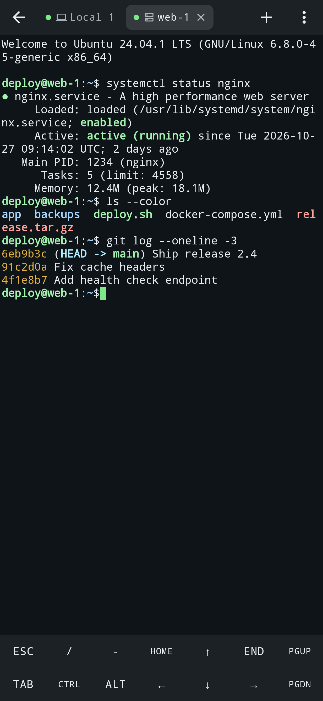
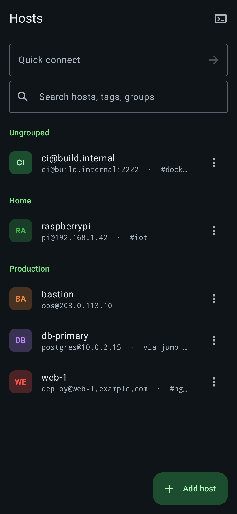
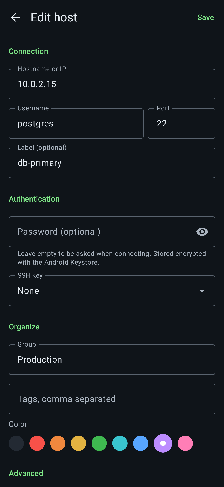
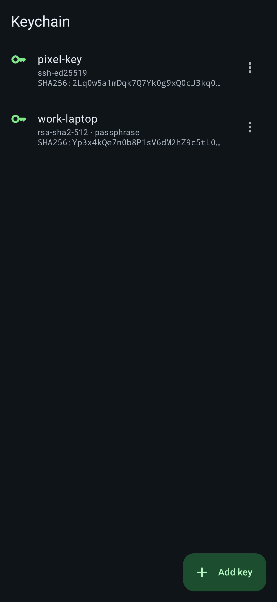

# Vibez — terminal & SSH client for Android

A native Android terminal that combines a local shell (like Termux) with a full SSH client
(like Termius): saved hosts, a keychain, jump hosts, port forwarding, SFTP and snippets — in one app,
with sessions that keep running in the background.

<p>
  
  
  
  
</p>

## Features

**Terminal**
- Full xterm-compatible emulator (256 colors, true color, mouse reporting, alternate screen — vim, htop, tmux all work).
- Multiple tabs, mixing local and SSH sessions; activity indicator on background tabs.
- Sessions survive leaving the app: a foreground service keeps them alive, with "Exit all" and a wake-lock toggle in the notification.
- Extra keys row (Esc, Ctrl, Alt, arrows, PgUp/PgDn, F-keys, …): sticky modifiers (tap = once, long-press = lock), auto-repeat on held arrows/backspace, fully customizable layout.
- Volume down = Ctrl, volume up = Fn (W/A/S/D arrows, 1–0 = F1–F10), Termux-compatible.
- Hardware keyboard shortcuts: Ctrl+Shift+V paste, T new tab, W close, ←/→ switch tabs, +/- zoom.
- Pinch to zoom, long-press to select and copy, share transcript, visual or vibrating bell.
- 12 color themes (Dracula, Tokyo Night, Catppuccin, Nord, Gruvbox, Solarized, …), per-host theme override, custom fonts (e.g. Nerd Fonts).

**Local shell**
- Runs the device's own shell (`/system/bin/sh`, toybox userland) on a real pseudo-terminal.
- Persistent home directory, history, colored prompt and aliases from `~/.vibezrc` (yours to edit).

**SSH (Termius-style)**
- Hosts with groups, tags, colors, search and quick connect (`user@host:port` or a pasted `ssh user@host -p 2222`).
- Password, keyboard-interactive (2FA prompts) and public key authentication; saved passwords are optional.
- Keychain: generate Ed25519 / ECDSA / RSA keys, import OpenSSH, PEM or PuTTY keys (passphrases supported), copy or share public keys.
- Host key verification with SHA256 fingerprints, and a loud warning when a known host's key changes.
- Jump hosts (ProxyJump), chained as deep as you need.
- Port forwarding: local (-L), remote (-R) and dynamic SOCKS5 (-D).
- SFTP browser: browse, upload, download, rename, delete, mkdir, chmod — reusing an open terminal connection when there is one.
- Startup command per host (e.g. `tmux new -A -s main`), keep-alive, compression, modern algorithms including post-quantum `mlkem768x25519-sha256` key exchange.
- Snippets: saved commands, run in the current session with one tap.

**Security**
- Passwords and private keys are encrypted with an AES-256-GCM key held in the Android Keystore.
- Optional app lock (fingerprint, face or device PIN) and screenshot blocking.
- No cloud, no accounts, no analytics. Android backups are disabled so secrets never leave the device.

## Install

Download the APK from the latest run of the [Android workflow](../../actions/workflows/android.yml)
(artifact `vibez-apks`), or build it yourself:

```sh
./gradlew assembleDebug        # app/build/outputs/apk/debug/app-debug.apk
./gradlew assembleRelease      # minified; signed with the debug key — use your own key to publish
```

Requirements: JDK 17+, Android SDK 36. The NDK and CMake versions pinned in
`terminal-emulator/build.gradle.kts` are installed automatically by the Android Gradle plugin.
Android 8.0 (API 26) or newer is supported.

## Tests

```sh
./gradlew testDebugUnitTest lintDebug
```

- **SSH end to end** — `SshIntegrationTest` runs the real SSH stack against an in-process SSH server:
  password and key logins, host key trust/rejection/changed-key warnings, shell exit codes, SFTP,
  local and SOCKS forwarding, jump hosts and cancellation.
- **Crypto compatibility** — every algorithm JSch can negotiate is loaded and the post-quantum
  key exchanges are round-tripped against BouncyCastle.
- **Screenshots** — `ScreenshotTest` renders the main screens with Robolectric into
  `app/build/screenshots/` (the images above).
- Unit tests for key handling, quick connect parsing, storage and the extra keys layout.

## Project layout

| Module | Contents |
| --- | --- |
| `terminal-emulator` | VT/xterm emulator from Termux (Apache-2.0), made transport-agnostic (`TerminalBackend`), plus a new native PTY implementation (`src/main/cpp/pty.c`, 16 KB page aligned). |
| `terminal-view` | The Android view that renders the emulator, from Termux (Apache-2.0). |
| `app` | Kotlin + Jetpack Compose app: SSH (`ssh/`), sessions and service (`terminal/`), storage (`data/`), UI (`ui/`). |

## Limitations

- No package manager: unlike Termux there is no `pkg install`; the local shell uses the tools that ship with Android.
- No Mosh, telnet or serial connections yet, and no cloud sync between devices.
- SSH agent forwarding and X11 forwarding are not supported.

## Licenses

The `terminal-emulator` and `terminal-view` modules are derived from
[Termux](https://github.com/termux/termux-app) and licensed under the Apache License 2.0 (see the
`LICENSE` and `NOTICE` files in those modules). Other dependencies: JSch (BSD), Bouncy Castle (MIT),
AndroidX and Kotlin (Apache 2.0).
