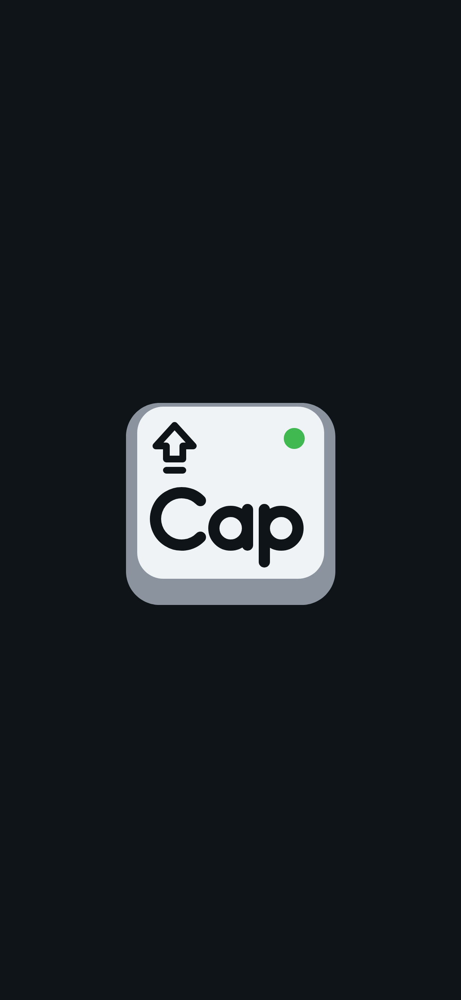
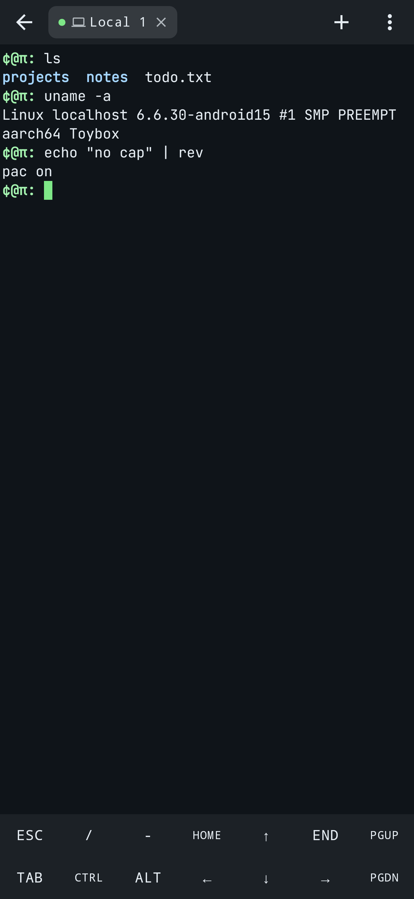
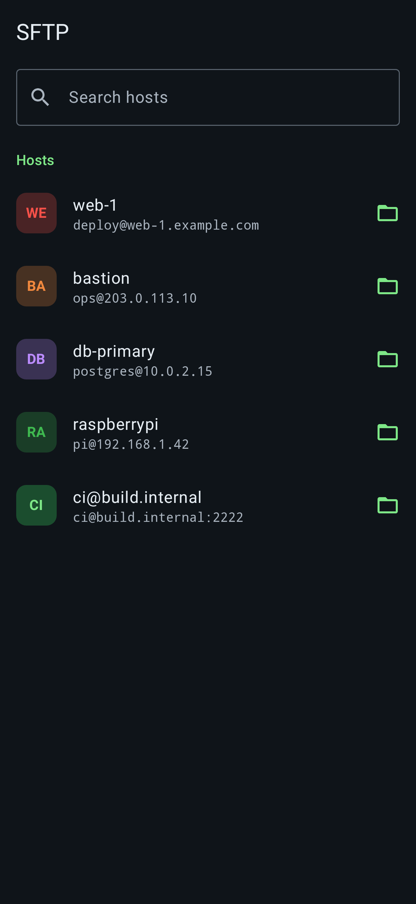
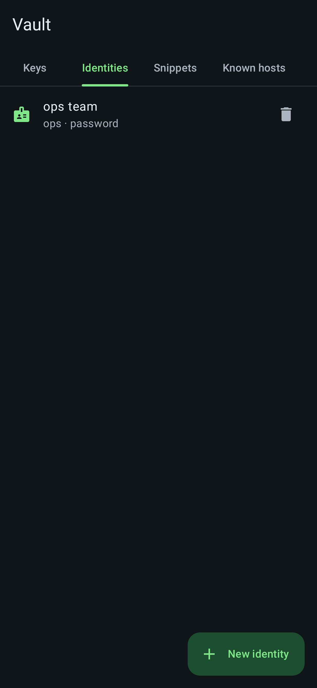

<p align="center">
  
</p>

# No Cap Terminal

A terminal and SSH client for Android that does what Termux and Termius do, in one app, with no
account needed. A real local shell, SSH and Telnet, SFTP, keys, identities, jump hosts, port
forwarding, snippets, 42 themes and 28 fonts.

The logo is a Caps Lock key with the "s Lock" missing: just **Cap**. The local shell prompt is `¢@π:`.

<p>
  
  
  
  
  
</p>

## Features

**Terminal**
- Full xterm-compatible emulator: 256 colors, true color, mouse reporting, alternate screen (vim, htop, tmux).
- Tabs mixing local, SSH and Telnet sessions. Sessions keep running in the background; the notification has "Exit all" and a wake-lock toggle.
- Extra keys row (Esc, Ctrl, Alt, arrows, F-keys…) with sticky modifiers, auto-repeat and a customizable layout.
- Volume down = Ctrl, volume up = Fn (Termux compatible); hardware keyboard shortcuts.
- Pinch to zoom, select and copy, share or save session output to a file.
- **42 color themes** (Dracula, Tokyo Night, Catppuccin ×4, Rosé Pine ×3, Nord, Gruvbox, Kanagawa, GitHub, Solarized, Synthwave, Matrix, Amber CRT…) plus a per-host theme.
- **28 bundled fonts** (JetBrains Mono, Fira Code, Source Code Pro, IBM Plex Mono, Victor Mono, Geist Mono, Ubuntu Mono, Space Mono, VT323…) with live previews, or import your own .ttf/.otf.

**Local shell (Termux-style)**
- The device's own shell on a real pseudo-terminal, with persistent home and history.
- Prompt `¢@π:` by default; change the text or show the current folder in Settings.
- `~/.nocaprc` holds aliases and prompt setup, yours to edit.

**Remote (Termius-style)**
- Hosts with groups, tags, colors, search and quick connect (`user@host:port`, or paste `ssh user@host -p 22`).
- SSH and Telnet.
- Password, keyboard-interactive (2FA) and key authentication.
- **Identities**: reusable username + password/key shared by many hosts.
- **Keychain**: generate Ed25519/ECDSA/RSA keys, or import OpenSSH, PEM and PuTTY keys.
- Host key verification with fingerprints, and a loud warning when a key changes.
- Jump hosts (ProxyJump chains), SOCKS5/HTTP proxies, agent forwarding, environment variables, startup command, keep-alive, compression.
- Port forwarding: local (-L), remote (-R) and dynamic SOCKS5 (-D), with or without a shell (**tunnel-only** sessions).
- **SFTP**, its own tab: browse, upload, download, rename, delete, mkdir, chmod, hidden files, sorting, filtering, a **built-in text editor** and "open with" other apps. It reuses an open SSH connection when there is one.
- **Snippets** with variables: `docker logs -f {{container}}`, `git checkout {{branch:main}}`.
- **Import `~/.ssh/config`**, following OpenSSH's own rules (wildcards, first match wins).
- Modern algorithms, including post-quantum `mlkem768x25519-sha256` key exchange.

**No account, no cloud**
- Instead of cloud sync: an **encrypted backup file** (AES-256-GCM, PBKDF2 password) with hosts, keys, identities, snippets, known hosts and settings. Import it on your new phone.
- Secrets are encrypted with an Android Keystore key. Optional fingerprint/PIN app lock and screenshot blocking.
- No analytics. Android cloud backup is disabled so secrets never leave the device.
- App accent colors (8) or Material You wallpaper colors; light, dark or system theme.

## Install

Download the APK from the latest run of the [Android workflow](../../actions/workflows/android.yml)
(artifact `nocap-terminal-apks`), or build it:

```sh
./gradlew assembleDebug        # app/build/outputs/apk/debug/app-debug.apk
./gradlew assembleRelease      # minified; signed with the debug key — use your own key to publish
```

Requirements: JDK 17+, Android SDK 36. Runs on Android 8.0 (API 26) and newer.

## Tests

`./gradlew testDebugUnitTest lintDebug` runs 62 tests, including:
- **SSH end to end** against an in-process SSH server: password, key and identity logins; host key trust, rejection and changed-key warnings; shell exit codes; environment variables; SFTP; local and SOCKS forwarding; tunnel-only sessions; SOCKS5 proxy; jump hosts; cancellation.
- **Telnet** option negotiation against a fake Telnet server.
- **Crypto compatibility**: every algorithm JSch can negotiate, plus post-quantum key exchange round trips.
- **Backup** round trip and wrong-password rejection; `~/.ssh/config` import; snippet variables.
- **Prompt**: the startup file is run in mksh (Android's shell) when available, and the prompt is checked to be `¢@π:`.
- **Fonts and themes**: every bundled font loads and every theme is complete.
- **Screenshots**: Robolectric renders the screens above into `app/build/screenshots/`.

## Not included (yet)

- No package manager: no `pkg install` like Termux; the local shell uses Android's built-in tools.
- No Mosh, serial connections or split-screen panes.
- No cloud sync or team sharing (by design: no accounts). Use the encrypted backup instead.

## Licenses

`terminal-emulator` and `terminal-view` are derived from [Termux](https://github.com/termux/termux-app)
(Apache License 2.0; see the `LICENSE` and `NOTICE` files in those modules). Bundled fonts are under
the SIL Open Font License 1.1 or the Ubuntu Font Licence 1.0; each font's license is in
`app/src/main/assets/fonts/licenses/`. Other dependencies: JSch (BSD), Bouncy Castle (MIT), AndroidX
and Kotlin (Apache 2.0).
